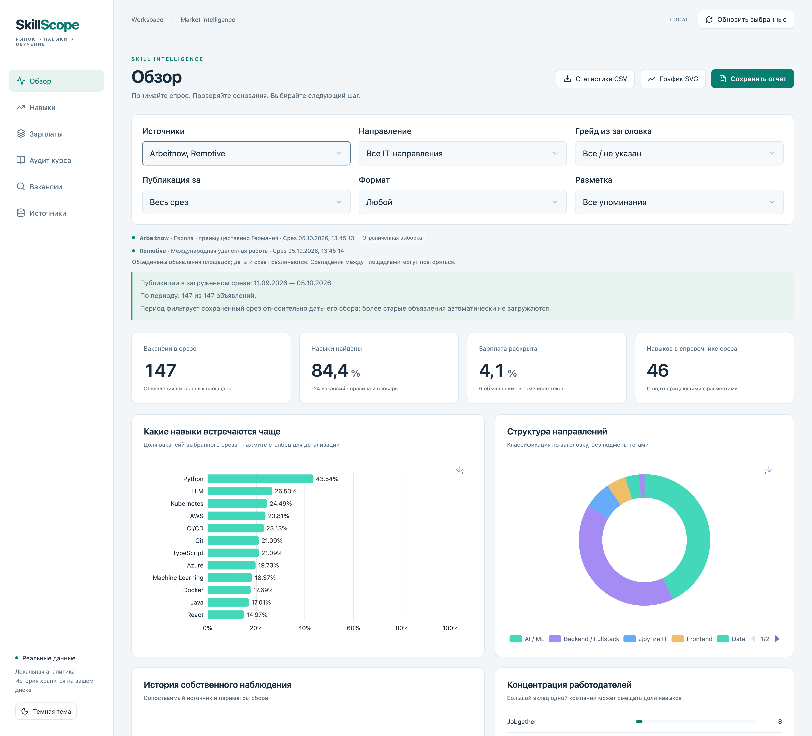
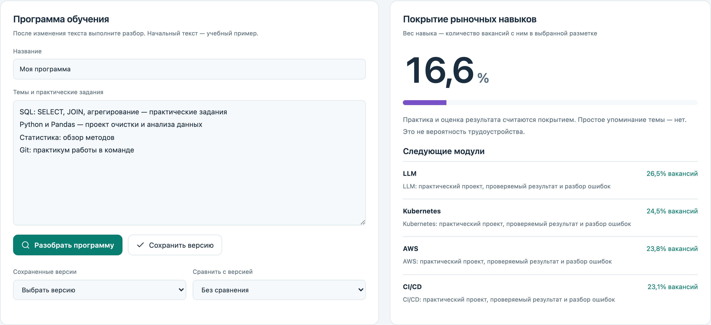

# SkillScope

**Аналитика IT-вакансий и проверка актуальности учебных программ.**

SkillScope собирает вакансии, выделяет навыки с фрагментами-основаниями и сопоставляет требования работодателей с учебной программой. Помогает найти недостающие практические темы и подготовить отчёт для обсуждения программы обучения.

[English](README.md) · [Кейс портфолио](https://evgeny-meleshkevich.github.io/work/skill-scope/?lang=ru)



## Возможности

- Сбор Arbeitnow и Remotive, адаптер официального API HH и импорт JSON.
- Фильтры по источникам, направлению, грейду, формату работы и возрасту публикации; карточки вакансий с цитатами и ссылками.
- Рейтинг навыков, матрица «навык × направление», структура работодателей и сопоставимые зарплатные группы.
- Разбор учебной программы, ручное уточнение покрытия, поиск пробелов и сохранение версий.
- Статистика CSV, график SVG и сохранённый HTML-отчёт с печатью в PDF через браузер.
- Локальные срезы SQLite, версии обработки и сбор по расписанию при запущенном приложении.

## Быстрый запуск

Нужны Python 3.11+, Node.js 22.12+ и npm. Интерфейс приложения — русский.

```sh
./start.sh --demo
```

Откройте **http://127.0.0.1:8770**. Скрипт устанавливает зависимости и собирает интерфейс; для первой установки нужен интернет. Остановка — Ctrl+C. Другой порт: `PORT=8771 ./start.sh --demo`.

Демонстрация загружает **шесть вымышленных вакансий** в формате Arbeitnow в отдельную базу `data/demo`. Это не данные площадки и не рыночная статистика. Дата публикации задаётся при загрузке примера. Автоматический сбор выключен; ручной запуск сбора обращается к внешним API. Для просмотра примера выберите Arbeitnow. Текст учебной программы — `examples/curriculum.txt`.

Для работы с реальными источниками:

```sh
./start.sh
```

Обычный режим использует собственную пустую базу в `data/`; расписание включено по умолчанию. Выберите источники и проверьте расписание в интерфейсе. Для HH может потребоваться переменная окружения `HH_TOKEN`; `HH_USER_AGENT` задаёт идентификатор приложения. Ключи задаются в окружении процесса. Внешняя LLM и платные ИИ-сервисы не нужны.

## Как считаются результаты

Навыки выделяются словарём и контекстными правилами. Требования, плюсы, упоминания и теги разделены. Автоматическая разметка может ошибаться; основания доступны для проверки. Доля навыка считается от всех вакансий выбранной выборки, включая объявления без распознанных навыков.

Зарплаты не смешиваются между валютами, периодами и gross/net. Для медианы середины вилки нужно не менее 30 сопоставимых диапазонов. История начинается с собственных наблюдений. Исчезновение из ограниченной выдачи не подтверждает найм. Покрытие программы показывает долю наблюдаемых навыков с практикой, а не качество курса или вероятность трудоустройства. Совпадения между площадками могут повторяться.

[Подробная методика](docs/METHODOLOGY.ru.md).



На снимках — сохранённая реальная выборка от 5 октября 2026 года: 136 объявлений Arbeitnow и 11 Remotive. Историческая база в репозиторий не включена. Снимки отличаются от вымышленных данных быстрого запуска и не описывают текущий рынок.

## Источники и хранение

Названия источников и исходные ссылки сохраняются в карточках и отчётах. Охват площадок различается; отказ источника показывается явно. Повторный сбор одной конфигурации ограничен интервалом в шесть часов.

- [Arbeitnow API](https://www.arbeitnow.com/blog/job-board-api).
- [Remotive API и условия использования](https://github.com/remotive-com/remote-jobs-api): публичный поток с задержкой 24 часа; ссылки и атрибуция сохраняются.
- [HH API](https://api.hh.ru/openapi/redoc): доступ зависит от авторизации и доступности площадки.

База, исходные ответы API и отчёты хранятся локально. Тексты сторонних вакансий не лицензируются этим репозиторием; условия их сбора и распространения определяются источниками.

## Проверка и устройство

```sh
.venv/bin/python -m pytest -q
npm run build --prefix frontend
```

Тесты используют временные базы и тестовые записи. Приложение слушает localhost и рассчитано на одного пользователя; серверная авторизация и разграничение прав не реализованы.

```text
backend/       API, сборщики, SQLite, извлечение и расчёты
frontend/      React, TypeScript, ECharts и стили
scripts/       Пересчёт сохранённых данных и загрузка примера
tests/         Проверки обработки, аналитики, экспорта и API
examples/      Вымышленные вакансии и учебный пример
docs/          Изображения и методика
start.sh       Локальный запуск
```

Зависимости перечислены в `requirements.txt` и `frontend/package.json`; точные версии сохранены в `requirements-lock.txt` и lockfile интерфейса. Для зависимостей действуют их собственные лицензии. Установленные пакеты, базы, ключи и созданные отчёты исключены из Git.
